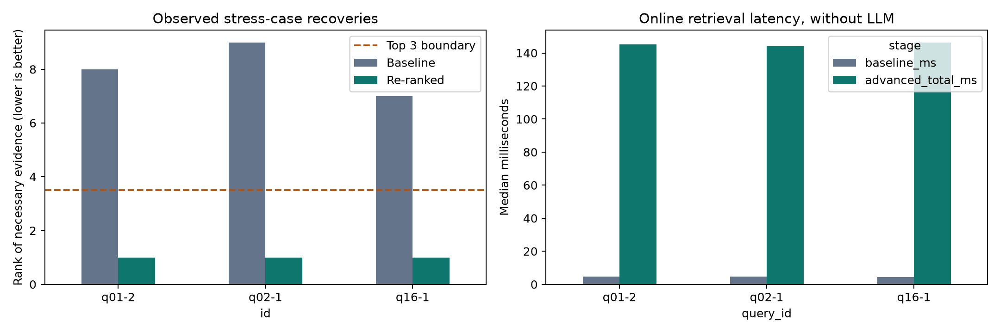

# RAG: Baseline Retrieval vs. Re-ranking
## Prabhash Padhan
## Roll: 2025201089
## M.Tech CSE

**Document:** Original 2016 GDPR regulation, 88 pages  
**Experiment date:** 18 October 2026  
**Answer model:** `deepseek/deepseek-v4.1-flash` through OpenRouter

## 1. Architecture comparison

Both pipelines use the same 391 chunks, created with a 210-token window and a 35-token overlap. The baseline embeds each chunk with `all-MiniLM-L6-v2` and stores the normalized vectors in a NumPy matrix. It embeds the query separately, retrieves the Top 10 by cosine similarity, and sends the first three chunks to the answer model.

A bi-encoder processes the query and passage independently. Document embeddings can therefore be computed once and reused. A cross-encoder processes the query and passage together, allowing joint self-attention between their tokens. This gives it more information for judging the relationship between a question and a particular passage.

The advanced pipeline uses `cross-encoder/ms-marco-MiniLM-L6-v2` to score all ten original query–chunk pairs. It sorts the candidates by that score and sends the best three to the same answer model. The prompt structure, temperature, seed, and output limit are identical in both pipelines; only the context changes.

## 2. Failure queries and answer comparison

Three examples show necessary evidence moving from outside the baseline Top 3 into the re-ranked Top 3. Labels include equivalent wording elsewhere in the PDF, so retrieving a recital that states the same restriction also counts as finding the evidence.

| Query | Critical chunk | PDF page | Baseline rank | Re-ranked rank |
| --- | --- | --- | --- | --- |
| Public authority and legitimate interests | `p009-c01` | 9 | 8 | 1 |
| Small organisation and processing records | `p051-c02` | 51 | 9 | 1 |
| Scientific research and purpose limitation | `p035-c02` | 35 | 7 | 1 |

### Public authority: role restriction

**Query:** A municipal authority wants to use legitimate interests rather than a statutory basis for its official duties. Is that basis available?

The baseline retrieved passages about public authorities and public-interest processing but missed the relevant restriction. Answer 1 stated that the excerpts were insufficient. Re-ranking promoted the recital explaining the restriction to rank 1. Answer 2 correctly answered no, citing `p009-c01`. This case shows why retrieving passages about the right subject does not necessarily retrieve the rule governing that subject's role.

### Small organisation: exception to an exemption

**Query:** Does an organisation with fewer than 250 employees always avoid keeping records of processing activities? What if processing is not occasional?

The baseline found passages about occasional processing, including an exemption associated with a different obligation. Answer 1 acknowledged that the excerpts did not establish the employee-count rule. Re-ranking promoted Article 30(5) from rank 9 to rank 1. Answer 2 explained that the small-organisation exemption does not apply when processing is not occasional, and identified the other exceptions in the retrieved clause.

### Scientific research: distractors and negation

**Query:** Is later use for scientific research automatically incompatible with the original purpose of collecting the personal data?

The baseline ranked passages discussing scientific research and information duties above the purpose-limitation rule. Answer 1 abstained. Re-ranking brought Article 5(1)(b) from rank 7 to rank 1. Answer 2 stated that further scientific-research processing is not considered incompatible with the initial purposes, in accordance with Article 89(1).

In these three cases, the improvement was from insufficient evidence and abstention to a supported answer. The saved baseline answers did not invent a rule. This distinction matters when assessing the effect of retrieval on answer quality.

## 3. Latency profiling

The benchmark ran on CPU with four PyTorch threads and Python 3.12.12. Each query was measured ten times after model warm-up, with randomized query order. Values below are medians; the final column is the advanced pipeline's 95th percentile.

| Query | Baseline (ms) | Re-ranking stage (ms) | Advanced total (ms) | Advanced p95 (ms) |
| --- | ---: | ---: | ---: | ---: |
| Public authority | 4.75 | 140.50 | 145.10 | 146.90 |
| Small organisation | 4.57 | 139.69 | 144.19 | 149.25 |
| Scientific research | 4.30 | 142.20 | 146.43 | 158.56 |

Baseline time includes query embedding and vector retrieval. Advanced total includes those steps plus cross-encoder scoring and sorting. These measurements exclude PDF processing, model loading, indexing, and answer generation. Each column is summarized independently, so rounded stage medians need not add exactly to the total median.

Re-ranking made online retrieval roughly 31–34 times slower in these cases. The additional cost was about 140 ms per query and supplied the missing evidence needed for the three answers. This is a measured tradeoff on this machine, rather than a general speed estimate for every deployment.

*Figure 1. Left: the necessary evidence moves from ranks 8, 9, and 7 to rank 1; lower ranks are better, and the dashed line separates the Top 3 from lower-ranked candidates. Right: median retrieval latency over ten runs per query. Advanced total includes dense retrieval and re-ranking; LLM answer generation is excluded. These are selected stress cases.*

## 4. Why not cross-encode the entire collection?

A cross-encoder's result depends on the query and passage being processed together. Its passage scores cannot be computed in advance for all future questions. Applying it directly to a collection of N chunks would require N query–passage evaluations for each question. In this experiment, that would mean 391 pairs instead of ten, or 39.1 times as many pair evaluations. The wall-clock ratio would also depend on batching and hardware.

Dense retrieval reuses precomputed document embeddings and performs comparatively cheap vector comparisons. It therefore provides a practical candidate-selection step before the more expensive cross-encoder. Larger collections can also use approximate nearest-neighbour indexes to reduce search cost.

The candidate stage remains a limit: a cross-encoder cannot promote a passage that was never retrieved. Across the 54 exploratory queries, six gained the necessary clause in the Top 3, while thirteen missed it in the initial Top 10. The pool contains related variants of eighteen clause targets, so these counts describe the stress test rather than an unbiased accuracy benchmark.

An additional breach-notification example exposed a chunk-boundary problem: a retrieved passage ended before the requirement that a public communication inform people equally effectively. Its answer omitted that condition. The evidence label was tightened to require the complete clause, and this example was excluded from the successful cases.

**Evidence files:** `results/rank_shifts.csv`, `results/answer_comparisons.json`, `results/latency_raw.csv`, `results/latency_summary.csv`, `results/query_metrics.csv`, and `results/context_boundary_case.json`. The executed implementation is in `Baseline_vs_Reranking.ipynb`.

**Document source:** [Official original GDPR PDF, EUR-Lex](https://eur-lex.europa.eu/legal-content/EN/TXT/PDF/?uri=CELEX:32016R0679). The experiment uses this fixed 2016 text.
